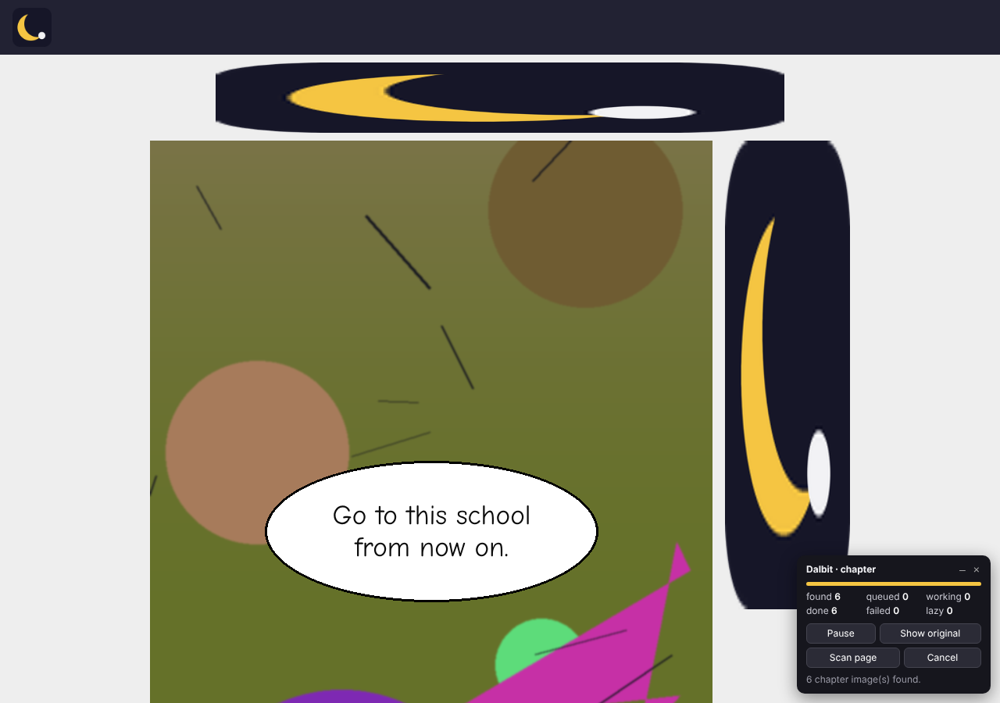

# Dalbit (달빛): a local manhwa translator

Open a chapter, press **Translate chapter** once, and read it in English. Dalbit finds the chapter's images, including lazy-loaded and very tall long-scroll strips. It processes them nearest-first and draws translations over the original art without changing it.

OCR and translation run **on your own computer**, by default **inside the browser itself**. There's no server to start, no API keys, no accounts and no usage limits, and images never leave your machine. An optional local Python service is available as a second engine.

- Browsers: **Chrome 116+** and **Firefox 128+** on desktop, from one codebase.
- Default pair: **Korean → English**. The interfaces are ready for Japanese and Chinese.
- Docs: [architecture](docs/ARCHITECTURE.md) · [models, licences and hardware](docs/MODELS.md) · [measurements and tests](docs/BENCHMARKS.md) · [Android options](docs/ANDROID.md)



## What you get

- **Whole-chapter flow.** One click translates the chapter.
  - Discovery handles `src`/`srcset`/`<picture>`, common lazy-load attributes and pages added later. It skips logos, avatars, banners and ads, and explains when it finds nothing.
  - An optional **Scan page** pass loads lazy images and then returns you to exactly where you were.
- **Long-scroll ready.**
  - Tall strips are processed in bounded, overlapping tiles. A 40,000 px strip adds ~100 MB of RAM.
  - Duplicates in the overlap are merged, and text cut by a tile edge is re-detected.
  - Images near your reading position go first.
- **Controls.** A progress panel (found, queued, working, done, failed, lazy) with pause, resume, cancel, retry failed and an original/translated toggle. Settings: target language, text size, sound-effect mode and glossary.
- **Readable, non-destructive lettering.**
  - In flat bubbles, only the glyph pixels are covered with the bubble colour. Outlines and tails stay untouched.
  - Text is fitted with real font metrics, then balanced wrapping, then a bounded shrink. If it still doesn't fit, you get an expandable "more" caption rather than lost words.
  - Text on artwork gets a readable plate.
  - Everything is an overlay. The page's image is never modified.
- **Sound effects: preserve + annotate.**
  - The original lettering stays. A small English chip is placed in the calmest nearby space, slightly tilted like the effect.
  - Known effects come from a Korean SFX lexicon. Unknown ones are shown as a romanised reading ("GWANG! (sound)") rather than an invented meaning.
  - A "?" marks uncertainty. "Original only" hides the chips.
- **Item windows and stat sheets keep their structure.**
  - In game-style system boxes, each line gets its own translation, drawn at the same place, left-aligned like the original, with one font size.
  - Two-column stat lists stay in two columns, and a sentence that wraps over two lines is translated as one sentence, then spread back over both lines.
  - Common system words (스탯, 민첩, 방어력, 등급…) use a built-in glossary inside these windows only.
- **Robust rendering.** Text is measured as the browser actually draws it and must fit its box. It wraps or shrinks; it never runs off the image, even with page zoom or scaled reader containers.
- **Site watermarks are ignored.** Faint, low-contrast lettering (such as a site's logo text) is not translated. It is reported in the results instead of being hidden silently.
- **Corrections.** Click any translation to see the Korean original and OCR confidence, fix the Korean, re-translate just that bubble, or edit the English. Edits are saved per image.

## Two engines

| | **Built-in** (default) | **Local service** (optional) |
|---|---|---|
| What runs | ONNX Runtime Web + Mozilla Bergamot WASM inside the extension | Python (ONNX Runtime) + Bergamot in Node, on 127.0.0.1 |
| Setup | Install the extension. That's all. | Python 3.10+, Node 18+, one setup script |
| Speed (4-thread CPU, 720×1400 page) | ~0.5–1 s with 3 threads (Chrome); slower single-threaded | ~0.4–0.7 s |
| Download size | Extension ≈ 97 MB (models included) | ~70 MB of models + ~400 MB Python packages |
| Memory | engine ≈ 0.6 GB while translating | ≈ 0.3–0.5 GB |

Both produce the same structured results and share all of the extension's discovery, scheduling and rendering. Pick the engine in the popup's **Settings**.

## Setup

### 1. Build the extension

You need Node.js 18+ to build:

```bash
cd extension
npm ci
npm run build          # downloads + verifies the models (~60 MB), then builds dist/chrome and dist/firefox
```

`npm run build` fetches the PP-OCRv6 detector (from the RapidOCR wheel on PyPI) and Mozilla's ko→en model, checking pinned SHA-256 hashes. The Korean recogniser is in the repo. For the better full-Hangul recogniser (recommended; see Known limitations), fetch it before building:

```bash
cd extension
npm run fetch-models -- --ppocr-korean && npm run build:only
```

The engine self-tests that model when it loads and falls back to the default recogniser if it misreads.

### 2. (Optional) Local service

Only needed if you choose the "Local service" engine.

```bash
cd service
bash scripts/setup.sh          # Windows: powershell -ExecutionPolicy Bypass -File scripts\setup.ps1
.venv/bin/python -m dalbit serve   # http://127.0.0.1:47615, loopback only
.venv/bin/python -m dalbit token   # pairing token for the extension
```

It no longer needs PyTorch. `python -m dalbit translate page.png` translates one image from the command line and writes a preview PNG.

### 3. Requirements

- **Built-in engine:** Chrome 116+ or Firefox 128+, about 1 GB of free RAM while translating, and a recent 64-bit CPU. Multi-threading is used where the browser allows it: Chrome yes, Firefox currently single-threaded.
- **Service:** Python 3.10+, Node.js 18+, about 0.5 GB RAM, and about 0.5 GB of disk.

### 4. Install it

**Chrome (desktop)**: open `chrome://extensions`, enable **Developer mode**, click **Load unpacked** and pick `extension/dist/chrome`. An unpacked extension stays installed across restarts. Chrome only installs packaged `.crx` files from the Chrome Web Store (or by enterprise policy), so for personal use keep it unpacked. A store upload would use `dist/packages/dalbit-chrome-*.zip`.

**Firefox (desktop)** has two routes:

- **Temporary (development)**: open `about:debugging#/runtime/this-firefox`, choose **Load Temporary Add-on…** and pick `extension/dist/firefox/manifest.json`. It is removed when Firefox restarts.
- **Permanent**: Firefox Release and ESR only install **signed** add-ons. Sign it for self-distribution ("unlisted") with free AMO API credentials, then install the resulting `.xpi` by dragging it into Firefox:
  ```bash
  cd extension
  npx web-ext sign --source-dir dist/firefox --channel unlisted --api-key "$AMO_JWT_ISSUER" --api-secret "$AMO_JWT_SECRET"
  ```
  Alternatively, Firefox Developer Edition or Nightly can install unsigned add-ons after setting `xpinstall.signatures.required` to `false` in `about:config`.
- On Firefox, click **Allow access to page images** in the popup the first time. Firefox treats MV3 host permissions as opt-in.

### 5. Use it

1. Click the Dalbit icon. The status should read *built-in ready*. Only if you switched to the local service do you paste its token in **Settings**.
2. Open a chapter and press **Translate chapter** (or **Alt+Shift+T**). **Alt+Shift+O** toggles original/translated.
3. If the panel says images are "lazy" and have no URL yet, press **Scan page**.
4. Click a translation to correct it.

Scope is the current page only. Dalbit never navigates to the next chapter.

## Tests

```bash
cd extension && npm test                                # 47 unit tests (engine + extension logic)
cd extension && npm run build && node test/e2e/run-builtin.mjs   # built-in engine in Chromium, no service
cd extension && npm run test:e2e                        # 27 checks in Chromium against the local service
cd extension && npm run lint:firefox                    # Mozilla add-ons linter
cd service && bash scripts/fetch_test_fonts.sh && .venv/bin/python tests/fixtures/generate.py && .venv/bin/python -m pytest   # 41 tests
```

Put your own pages in `samples/user/`. That folder is git-ignored, and the built-in e2e run includes them.

## Known limitations

- **The default Korean recogniser knows only 913 Hangul syllables.** Common ones like 었, 봐, 뭘, 됩 and 았 are missing, so it misreads them ("있었습니다" → "있없습니다"), and those errors reach the translation. This was found on your real pages. The fix is the full-Hangul PaddleOCR model: `npm run fetch-models -- --ppocr-korean`. Its download host was blocked in my build environment, so that model is implemented, self-tested at load, and verified on the identical code path with another Paddle model, but **not yet run on Korean**.
- **Large stylised sound effects are often not detected at all** (e.g. a huge vertical 화르륵, outlined 콰앙). The text detector is trained on ordinary text. These effects stay untouched, with no English label.
- **Translation is sentence-level NMT** with no story context: 마수 (magical beast) comes out as "horse". Add terms to the **glossary** (`마수 = magical beast`). Names stay consistent only through the glossary.
- **Cleanup** only happens in flat-colour containers. Text over illustrations gets a readable plate instead of inpainting. Text colour falls back to black or white when the estimated colour would be hard to read.
- **Sites.** Readers that draw pages into `<canvas>`, scramble tiles or use CSS background images are not discovered (the panel says so).
- **Firefox** shares all code with Chrome and passes the linter (0 errors, 1 warning from ONNX Runtime's own loader), but was not run in a real Firefox. Its built-in engine runs single-threaded.

## Next three improvements

1. **Full-Hangul recogniser by default.** Run `--ppocr-korean` on a machine that can reach ModelScope, measure it on real pages, and make it the default if it wins. The self-test already guards the switch.
2. **Sound-effect detection.** Add a detector that finds large stylised lettering (licence-checked, or trained on your own annotated pages), plus tap-to-annotate as a manual fallback.
3. **Context-aware translation option.** An optional local LLM (Apache-2.0 Qwen3) with a chapter glossary, keeping Bergamot as the fast default. Also verify Firefox at runtime.

## Licences

Dalbit's own code is currently **all rights reserved** (see `LICENSE`). Pick a licence before sharing or selling it. Bundled fonts are SIL OFL 1.1. Models and libraries are Apache-2.0, MPL-2.0, MIT or BSD; see `THIRD_PARTY_NOTICES.md` and [docs/MODELS.md](docs/MODELS.md). Before a commercial release, also check the name "Dalbit" for trademark conflicts.
